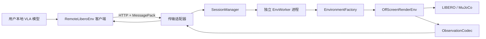
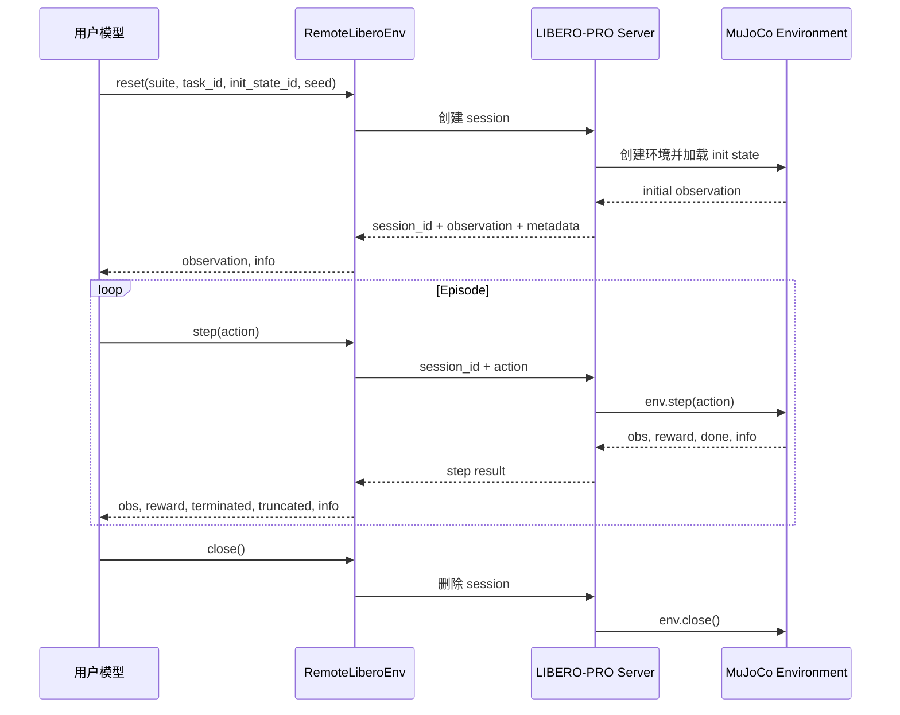

# LIBERO-PRO Remote Evaluation Service

> 状态：第一阶段可运行实现（v0.1）
> 当前阶段：本地自动化测试已通过，等待 Linux/NVIDIA 服务器真实 LIBERO 验收

## 1. 当前任务

将 LIBERO-PRO 从“用户下载代码和数据后在本地部署”的评测方式，改造成一个可远程调用的环境评测服务：

- LIBERO、MuJoCo、BDDL、初始状态和扰动规则都运行在服务端。
- 用户的 VLA 模型运行在用户本地。
- 服务端向用户返回 observation，用户模型计算 action 后再发回服务端。
- 服务端执行 action，推进环境并返回下一步 observation、reward、终止状态和成功状态。
- 客户端保持接近 Gym 环境的调用体验，只需要使用 `reset()`、`step()` 和 `close()`。

仓库已经实现第一阶段的协议、独立环境 worker、session 生命周期、HTTP 服务和
Python 客户端。当前代码可以使用确定性的 `fake` 后端完成本地端到端验证；上传到
Linux/NVIDIA 服务器后，切换为默认的 `libero` 后端进行真实 MuJoCo/EGL 验收。

## 快速验证

开发环境使用 Python 3.8，以保持与 LIBERO-PRO 的运行环境一致：

```bash
python3.8 -m venv .venv
source .venv/bin/activate
python -m pip install -e ".[dev]"

LIBERO_REMOTE_BACKEND=fake \
LIBERO_REMOTE_HOST=0.0.0.0 \
libero-remote-server
```

另一个终端执行：

```bash
curl http://127.0.0.1:8000/v1/health
python scripts/server_smoke_test.py --base-url http://127.0.0.1:8000
```

`fake` 后端不依赖 LIBERO、MuJoCo 或 GPU，只用于验证网络、数组编解码、请求顺序和
资源清理，不能替代真实评测结果。

## 服务器部署

首个真实部署建议直接在 Linux GPU 服务器上构建。服务器需要 Docker、NVIDIA 驱动和
NVIDIA Container Toolkit；客户端机器只需要 Python 包，不需要安装 LIBERO 或 MuJoCo。

```bash
git clone https://github.com/Zxy-MLlab/LIBERO-Pro2.0.git
cd LIBERO-Pro2.0
cp .env.example .env
docker compose build
docker compose up -d
docker compose ps
docker compose logs -f libero-remote
```

镜像固定拉取 `LIBERO-PRO` 的 commit
`eafdb809426b13153aa1e4c42d6601844217dfec`，并安装 Python 3.8、CUDA 11.3 对应的
PyTorch、robosuite、MuJoCo 和本服务。基础四个 suite 的 BDDL/init state 随该 commit
进入镜像；Hugging Face 上的扰动数据属于第二阶段，不在第一阶段加载。

启动后先检查廉价就绪探针：

```bash
curl http://SERVER_IP:8000/v1/health
curl http://SERVER_IP:8000/v1/tasks
```

再从另一台机器运行一次真实环境 smoke test：

```bash
git clone https://github.com/Zxy-MLlab/LIBERO-Pro2.0.git
cd LIBERO-Pro2.0
python3.8 -m venv .venv
source .venv/bin/activate
python -m pip install .
python scripts/server_smoke_test.py --base-url http://SERVER_IP:8000
```

smoke test 会真实执行 `health -> create/reset -> step -> close`。只有它通过，才能说明
服务器上的 LIBERO 数据、MuJoCo、EGL、NVIDIA runtime 和 session 清理链路同时可用。

### 部署约束

- 第一阶段没有鉴权和限流，只能放在可信内网、VPN 或 SSH 隧道后，不能直接暴露公网。
- Uvicorn 必须保持单 API 进程。每个 session 已有独立 `spawn` worker，不能再用多个
  Uvicorn worker 分割内存中的 session registry。
- `LIBERO_REMOTE_MAX_SESSIONS` 默认是 `1`；提高前先测量单环境 GPU 显存和主存。
- `step` 超时后不要生成新 `request_id` 盲目重试；用原 `request_id` 安全重放。
- `/v1/health` 只检查进程、基础数据目录和容量；真实渲染是否可用由 smoke test 验证。

### 主要配置

| 环境变量 | 默认值 | 作用 |
| --- | ---: | --- |
| `LIBERO_REMOTE_PUBLIC_PORT` | `8000` | Compose 暴露的服务器端口 |
| `LIBERO_REMOTE_MAX_SESSIONS` | `1` | 同时占用环境资源的 session 上限 |
| `LIBERO_REMOTE_WORKER_TIMEOUT_SECONDS` | `120` | 单次 worker 命令超时；超时后 worker 被终止 |
| `LIBERO_REMOTE_SESSION_IDLE_TIMEOUT_SECONDS` | `900` | session 空闲回收时间 |
| `LIBERO_REMOTE_CLEANUP_INTERVAL_SECONDS` | `30` | 后台扫描空闲 session 的间隔 |
| `NVIDIA_VISIBLE_DEVICES` | `all` | 容器可见 GPU；生产环境建议指定设备 |
| `LIBERO_PRO_COMMIT` | 固定 commit | 构建时使用的 LIBERO-PRO 版本 |

## 代码作用

| 路径 | 作用 |
| --- | --- |
| `libero_remote/protocol/models.py` | 定义协议版本、请求字段、状态和稳定错误码 |
| `libero_remote/protocol/codec.py` | 用 MessagePack 无损编解码 NumPy dtype、shape 和原始字节 |
| `libero_remote/environment/` | 统一真实 LIBERO 与测试后端的 `create/reset/step/close` 接口 |
| `libero_remote/environment/libero.py` | 查找 suite/task/init state 并包装 `OffScreenRenderEnv` |
| `libero_remote/environment/observations.py` | 白名单化并规范两路图像和机器人本体状态 |
| `libero_remote/environment/readiness.py` | 不初始化 MuJoCo 的后端与基础数据就绪检查 |
| `libero_remote/worker/process.py` | 用 `spawn` 子进程隔离 MuJoCo/EGL，并处理超时和强制回收 |
| `libero_remote/server/session.py` | 保存单个 session 的 episode、step、锁和幂等缓存 |
| `libero_remote/server/session_manager.py` | 管理容量、顺序、幂等、失败、空闲过期和全局关闭 |
| `libero_remote/server/app.py` | FastAPI 路由、MessagePack 响应、错误映射和后台清理任务 |
| `libero_remote/server/settings.py` | 将环境变量转换为经过校验的服务配置 |
| `libero_remote/client/` | 提供 Gym 风格客户端、HTTP 连接复用和稳定异常类型 |
| `scripts/server_smoke_test.py` | 从客户端机器验证真实服务器完整交互链路 |
| `Dockerfile` / `compose.yaml` | 固定服务器依赖并以单 API 进程、GPU/EGL 模式启动 |
| `tests/` | 覆盖协议、worker 状态保持、session 幂等/回收和端到端调用 |

## 开发质量检查

```bash
python -m pytest -q
python -m mypy libero_remote
python -m ruff check libero_remote tests scripts
```

## 2. 背景

当前 LIBERO-PRO 的使用流程包含以下成本：

1. 用户需要下载 LIBERO-PRO 仓库、BDDL 文件和 init state 文件。
2. 用户需要安装指定版本的 Python、PyTorch、robosuite 和 MuJoCo。
3. 用户需要修改自己的模型评测代码来接入新增任务集。
4. 不同用户的本地环境差异容易造成安装失败或评测结果不可复现。
5. 静态 BDDL 文件公开后，模型可以直接基于评测任务收集数据并进行针对性训练。
6. 本地运行时，LIBERO-PRO 无法统一控制 episode 中途发生的动态扰动。

远程评测服务将环境和规则集中在服务器上，降低接入成本，同时为静态扰动、动态扰动、统一日志和后续排行榜提供一个稳定入口。

## 3. 总体路线

项目分四个阶段推进：

| 阶段 | 目标 | 本阶段是否实现 |
| --- | --- | --- |
| 第一阶段 | 原始 LIBERO 环境远程化，内网单用户打通完整交互链路 | 是 |
| 第二阶段 | 接入已有静态扰动，允许用户选择评测类型 | 否 |
| 第三阶段 | 接入运行时动态扰动，由服务端按规则触发 | 否 |
| 第四阶段 | 公网部署、并发调度、鉴权、限流、监控和排行榜 | 否 |

第一阶段只验证技术闭环，不提前解决并发和公网运营问题。

## 4. 第一阶段目标

第一阶段需要证明下面这条链路可行：

1. 用户在内网客户端创建指定的 LIBERO task。
2. 服务端创建一个独立环境实例并加载指定 init state。
3. 服务端把图像、机器人本体状态和任务信息传给客户端。
4. 客户端返回一个 action 向量。
5. 服务端执行 `env.step(action)`，返回下一步结果。
6. episode 成功、超出步数或客户端主动结束后，服务端释放环境。

### 第一阶段范围

- 支持 `libero_goal`、`libero_spatial`、`libero_object` 和 `libero_10`。
- 支持按 `suite + task_id + init_state_id + seed` 创建环境。
- 支持两路默认相机图像和机器人本体状态。
- 支持一个客户端、一个活跃环境、串行 step。
- 支持环境超时回收和显式关闭。
- 提供一个 Python 客户端包，隐藏网络协议和数组编解码细节。

### 第一阶段暂不包含

- 多用户并发和 GPU 调度。
- 公网鉴权、计费、配额和排行榜。
- 静态或动态扰动。
- 用户模型托管和服务端模型推理。
- 训练数据下载或世界模型训练。
- Web 管理后台。

## 5. 系统架构



设计重点是把复杂度放在服务端模块内部。调用方只学习一个很小的客户端接口，不需要知道 BDDL 路径、MuJoCo 状态、图像数组序列化或环境资源清理方式。

### 核心模块

| 模块 | 职责 |
| --- | --- |
| `RemoteLiberoEnv` | 向模型代码提供类似 Gym 的客户端接口 |
| 传输适配器 | 校验 HTTP 请求，将请求交给会话模块，并编码响应 |
| `SessionManager` | 管理环境生命周期、调用顺序、超时和资源释放 |
| `EnvWorker` | 在独立 spawn 进程中隔离 MuJoCo/EGL 环境和故障 |
| `EnvironmentFactory` | 根据 task 描述创建并初始化 LIBERO 环境 |
| `ObservationCodec` | 筛选 observation 字段并编解码 NumPy 数组 |
| `TaskCatalog` | 枚举允许调用的 suite、task 和 action/observation 元数据 |

第一阶段不额外抽象扰动模块。等第二阶段确实出现 `base` 与 `static perturbation` 两种实现后，再建立扰动选择的内部 seam。

## 6. 交互流程



环境按请求推进，不依赖真实时间连续运行。因此客户端模型推理耗时只会增加评测墙钟时间，不会让机器人在等待期间自行运动。

## 7. 客户端接口

用户侧只暴露以下主要接口：

```python
from libero_remote import RemoteLiberoEnv

env = RemoteLiberoEnv(
    base_url="http://10.0.0.8:8000",
    timeout=60.0,
)

obs, info = env.reset(
    suite="libero_goal",
    task_id=0,
    init_state_id=0,
    seed=42,
)

terminated = False
truncated = False

while not (terminated or truncated):
    action = model.predict(obs, instruction=info["language_instruction"])
    obs, reward, terminated, truncated, info = env.step(action)

env.close()
```

接口约束：

- 第一次 `reset()` 创建服务端 session。
- 一个 session 同一时刻只允许一个在途请求。
- `action` 必须匹配服务端返回的 action shape 和 dtype。
- episode 结束后必须再次 `reset()` 或调用 `close()`。
- 客户端上下文管理器退出时自动调用 `close()`。
- 网络超时不应自动重试 `step()`，否则同一个 action 可能执行两次。客户端需要使用 `request_id` 查询或安全重放。

## 8. HTTP 接口

第一阶段使用 FastAPI 提供同步请求响应接口。控制信息使用普通 JSON；包含 observation 的响应使用 `application/x-msgpack`，以便直接传输 NumPy 字节数据。

| 方法 | 路径 | 用途 |
| --- | --- | --- |
| `GET` | `/v1/health` | 进程和环境依赖健康检查 |
| `GET` | `/v1/tasks` | 获取可用 suite、task 和空间元数据 |
| `POST` | `/v1/sessions` | 创建环境 session |
| `POST` | `/v1/sessions/{id}/reset` | 重置当前环境 |
| `POST` | `/v1/sessions/{id}/step` | 执行一个 action |
| `GET` | `/v1/sessions/{id}` | 查询 session 状态和最后一个 request id |
| `DELETE` | `/v1/sessions/{id}` | 关闭环境并释放资源 |

### 创建 session

```json
{
  "protocol_version": "1.0",
  "suite": "libero_goal",
  "task_id": 0,
  "init_state_id": 0,
  "seed": 42,
  "variant": "base",
  "camera_names": ["agentview", "robot0_eye_in_hand"],
  "camera_height": 128,
  "camera_width": 128,
  "max_steps": 300
}
```

第一阶段只接受 `variant="base"`。保留该字段是为了让第二阶段在不修改客户端主接口的情况下增加静态扰动。

创建成功后返回：

```json
{
  "session_id": "01J...",
  "status": "ready",
  "suite": "libero_goal",
  "task_id": 0,
  "language_instruction": "put the bowl on the plate",
  "action_space": {
    "shape": [7],
    "dtype": "float32",
    "low": [-1, -1, -1, -1, -1, -1, -1],
    "high": [1, 1, 1, 1, 1, 1, 1]
  },
  "observation_space": {
    "agentview_image": {"shape": [128, 128, 3], "dtype": "uint8"},
    "robot0_eye_in_hand_image": {"shape": [128, 128, 3], "dtype": "uint8"}
  }
}
```

实际 action 维度和范围必须从创建后的环境读取，不能只在协议里硬编码为 7。

### 执行 step

```json
{
  "request_id": "episode-1-step-17",
  "action": [0.01, -0.02, 0.0, 0.1, 0.0, 0.0, 1.0]
}
```

逻辑响应为：

```text
protocol_version: "1.0"
request_id: "episode-1-step-17"
session_id: "01J..."
step_index: 17
observation: map<string, ndarray>
reward: float32
terminated: bool
truncated: bool
success: bool
info: map<string, scalar>
```

`terminated` 表示任务成功或环境自身结束；`truncated` 表示达到服务端配置的最大步数。不能把这两种结束原因合并成一个含义不明确的 `done`。

### 错误语义

| 状态码 | 场景 |
| --- | --- |
| `400` | action shape、dtype 或参数非法 |
| `404` | suite、task 或 session 不存在 |
| `409` | session 状态不允许当前操作，或已有 step 正在执行 |
| `410` | session 已超时并被回收 |
| `422` | 请求结构不符合协议 |
| `500` | LIBERO/MuJoCo 内部错误 |
| `503` | 服务端暂时没有可用环境资源 |

错误响应必须包含稳定的 `error_code`、可读消息和 `request_id`，客户端逻辑不能依赖错误字符串。

## 9. Observation 编码

第一阶段不使用 Base64，也不默认使用 JPEG。Base64 会额外增加约三分之一体积；JPEG 的有损压缩可能改变模型输入并影响评测公平性。

每个 NumPy 数组编码为：

```text
{
  "dtype": "uint8",
  "shape": [128, 128, 3],
  "data": <raw bytes>
}
```

要求：

- 数组统一转换为 C-contiguous。
- 协议中显式携带 dtype、shape 和字节序。
- 客户端解码后保持与服务端 observation 相同的键名。
- 只传输白名单字段，不直接序列化 LIBERO 返回的任意 Python 对象。
- `info` 中只允许标量、短字符串和受控的小型数组。
- 不对图像做转置、翻转、归一化或颜色空间转换；这些属于用户模型适配逻辑。

两路 `128 x 128 x 3` 的 `uint8` 图像每步约 96 KiB。即使每秒执行 20 step，单 session 的原始图像带宽约为 15 Mbit/s，内网第一阶段可以接受。压缩策略应在测量真实吞吐后决定。

## 10. Session 生命周期

```text
CREATING -> READY -> RUNNING -> TERMINATED
               ^         |
               |---------| reset

任意非 CLOSED 状态 -> CLOSED
长时间无请求       -> EXPIRED
内部不可恢复错误   -> FAILED
```

`SessionManager` 必须保证：

- 每个 session 只拥有一个环境实例。
- 同一 session 的操作严格串行。
- 每个成功 step 只递增一次 `step_index`。
- 重复的 `request_id` 返回缓存结果，不能重复执行 action。
- session 超时或失败后一定调用 `env.close()`。
- 进程退出时关闭全部环境。
- 响应日志记录 suite、task、step、耗时和结果，但不记录完整图像。

当前实现从第一阶段开始就为每个 session 启动独立 `spawn` worker。FastAPI 进程只保存
session 元数据、进程句柄和请求缓存，不直接导入或持有 MuJoCo 环境。

## 11. 与现有 LIBERO-PRO 的连接方式

当前仓库已经具备第一阶段所需的核心能力：

- `libero/libero/benchmark/__init__.py` 可以按 suite 和 task id 查找 BDDL 与 init state。
- `libero/libero/envs/env_wrapper.py` 中的 `OffScreenRenderEnv` 已提供 `reset()`、`step()`、`set_init_state()` 和 `close()`。
- `OffScreenRenderEnv.sim` 暴露底层 MuJoCo simulation，后续可用于动态扰动。
- 根目录 `perturbation.py` 已提供静态 BDDL 扰动组合逻辑，第二阶段可以接入。

环境创建实现可按以下流程完成：

```python
from libero.libero import benchmark
from libero.libero.envs import OffScreenRenderEnv


def create_environment(spec):
    suite_cls = benchmark.get_benchmark_dict()[spec.suite]
    suite = suite_cls()

    task = suite.get_task(spec.task_id)
    bddl_path = suite.get_task_bddl_file_path(spec.task_id)
    init_states = suite.get_task_init_states(spec.task_id)

    env = OffScreenRenderEnv(
        bddl_file_name=bddl_path,
        camera_names=spec.camera_names,
        camera_heights=spec.camera_height,
        camera_widths=spec.camera_width,
    )
    env.seed(spec.seed)
    env.reset()
    observation = env.set_init_state(init_states[spec.init_state_id])

    return env, task, observation
```

实际实现还需要校验 task id、init state id、相机配置、action space 和异常清理。

## 12. 推荐代码结构

```text
libero_remote/
  __init__.py
  protocol/
    models.py              # 请求、响应和错误模型
    codec.py               # NumPy / MessagePack 编解码
  environment/
    task_catalog.py        # suite 和 task 查询
    factory.py             # 创建并初始化 OffScreenRenderEnv
    adapter.py             # 统一 reset/step/close 的环境接口
  server/
    app.py                 # FastAPI 入口和传输适配器
    session.py             # Session 状态和值对象
    session_manager.py     # 生命周期、幂等、超时和清理
    settings.py            # 服务端配置
  client/
    remote_env.py          # 用户侧 Gym 风格接口
    transport.py           # HTTP keep-alive、超时和错误映射

tests/
  unit/
    test_codec.py
    test_session_manager.py
    test_protocol_models.py
  integration/
    test_environment_factory.py
    test_server_client_roundtrip.py
    test_local_remote_equivalence.py
```

不建议直接在 `env_wrapper.py` 中加入 HTTP 逻辑。环境代码只负责仿真，网络和会话逻辑放在新模块中，避免影响原有本地评测方式。

## 13. 技术选型

| 领域 | 第一阶段选择 | 原因 |
| --- | --- | --- |
| 服务框架 | FastAPI + Uvicorn | Python 接入简单，便于内网原型和接口校验 |
| 客户端 | `httpx.Client` | 支持连接复用、超时和明确的同步语义 |
| 数据协议 | MessagePack | 可传原始二进制，体积明显小于 Base64 JSON |
| 数组表示 | NumPy raw bytes + dtype + shape | 可无损恢复 observation |
| session id | UUIDv7/ULID | 不暴露递增用户数量且便于日志排序 |
| 配置 | YAML + 环境变量覆盖 | 与现有 LIBERO-PRO 配置方式相容 |
| 测试 | pytest | 适合协议、模块和端到端测试 |

当前 LIBERO-PRO 使用 Python 3.8.13。实现时应锁定最后一组兼容 Python 3.8 的 FastAPI/Pydantic/httpx 版本；不要直接安装当时的最新版。如果后续升级 Python，需要先验证 PyTorch、robosuite、MuJoCo 和渲染行为是否一致。

## 14. 第一阶段实施步骤

### 里程碑 1：协议和编解码

- 定义 session、task、step 和错误模型。
- 实现 NumPy/MessagePack 编解码。
- 完成 dtype、shape、非法数据和往返一致性测试。

### 里程碑 2：本地环境模块

- 实现 `TaskCatalog` 和 `EnvironmentFactory`。
- 用 `suite + task_id + init_state_id` 创建环境。
- 验证 `reset -> step -> close` 在无网络情况下正常工作。

### 里程碑 3：服务端 session

- 实现 session 状态机和操作串行化。
- 实现 request id 幂等保护。
- 实现超时回收、异常清理和健康检查。

### 里程碑 4：HTTP 传输与客户端

- 实现所有 `/v1` 路径。
- 实现 `RemoteLiberoEnv`。
- 将 HTTP 错误映射成稳定的 Python 异常类型。

### 里程碑 5：内网端到端验证

- 服务端和客户端分别运行在两台机器上。
- 使用固定 seed、init state 和 action 序列完成完整 episode。
- 记录吞吐、延迟、CPU/GPU 显存和环境释放结果。
- 编写最小用户接入示例。

## 15. 验收标准

第一阶段完成必须同时满足：

1. 客户端可以查询可用 task，并创建指定环境。
2. 客户端能收到两路图像、机器人状态和语言指令。
3. 客户端可以连续执行至少 300 个 step，step 顺序无错乱、无重复。
4. `terminated`、`truncated` 和 `success` 含义明确且结果正确。
5. 相同 seed、init state 和 action 序列下，本地与远程状态向量在约定误差内一致。
6. observation 经编解码后 dtype、shape 和原始字节保持一致。
7. 非法 action、错误 task 和过期 session 返回稳定错误码。
8. 正常结束、客户端断开、超时和内部异常都不会遗留环境实例。
9. 连续创建并关闭 100 次环境后，服务进程内存和显存没有持续增长。
10. 客户端示例代码不需要导入 LIBERO、MuJoCo 或读取 BDDL 文件。

图像一致性应区分两类测试：同一个 observation 的协议往返必须逐字节一致；两个独立 MuJoCo 实例的渲染结果可根据实际硬件设定像素误差阈值。

## 16. 第二阶段：静态扰动

第一阶段稳定后，将创建 session 的 `variant` 扩展为：

```text
base
object
swap
language
task
environment
combined
```

服务端根据 `variant` 选择已经准备好的 BDDL/init state 集合，或者调用现有 `perturbation.py` 生成受控环境。客户端只选择评测类型，不接触实际 BDDL 文件和扰动配置。

需要明确：把 BDDL 留在服务端只能提高直接获取和针对性训练的成本，不能从理论上彻底阻止通过大量查询推断评测分布。因此还需要访问配额、隐藏测试集轮换和异常查询检测。

## 17. 第三阶段：动态扰动

动态扰动在服务端的 `step` 流程中触发：

```text
校验 action
  -> before_step 规则
  -> env.step(action)
  -> after_step 规则
  -> sim.forward()
  -> 重新生成 observation
  -> 返回结果
```

可能包含：

- episode 执行到指定或随机步数后移动目标物体。
- 改变物体姿态、机器人初始位置或相机参数。
- 改变光照强度、方向、眩光和遮挡。
- 根据可复现的私有 seed 选择扰动时机和幅度。

所有动态扰动必须记录内部审计事件，但不能在普通客户端响应中泄漏隐藏规则。实现前需要为每种扰动规定物理可行范围和成功判定不变量。

## 18. 风险与处理

| 风险 | 处理方式 |
| --- | --- |
| MuJoCo 渲染上下文不是线程安全的 | 同一 session 严格串行；并发阶段采用独立 worker 进程 |
| step 超时后客户端重试导致动作执行两次 | 每个 step 携带唯一 `request_id`，服务端缓存最近结果 |
| 图像负载导致延迟或带宽过高 | 先测量原始数据；后续再增加可协商的无损压缩 |
| 服务崩溃遗留 GPU/环境资源 | `try/finally` 清理、超时回收、进程退出钩子和 worker 隔离 |
| 不同服务器版本产生评测差异 | 固定镜像、依赖 lock、代码 commit、任务版本和 seed |
| 用户访问隐藏任务过多导致信息泄漏 | 后续增加鉴权、配额、隐藏任务轮换和查询审计 |
| 旧依赖限制服务框架版本 | 第一阶段固定 Python 3.8 兼容依赖，升级单独验证 |

## 19. 待评审问题

开始编码前需要确认：

1. 第一阶段服务端部署在 Linux 服务器还是现有 Windows 环境？
2. 首个演示只支持 `libero_goal`，还是同时开放四个 10-task suite？
3. observation 必须返回哪些键？是否需要深度图和 segmentation？
4. 客户端接口是否需要兼容 Gymnasium 的 `Env` 类型？
5. 第一阶段是否接受 HTTP + MessagePack，还是直接使用 gRPC？
6. session 的默认空闲超时和单 episode 最大步数是多少？
7. 静态扰动选择由用户显式指定，还是服务端隐藏随机分配？
8. 评测结果由客户端汇总，还是服务端生成不可篡改的 episode 记录？

## 20. 预期第一阶段成果

完成后应提供：

- 一个可在内网启动的 LIBERO-PRO server。
- 一个可独立安装的轻量 Python client。
- 一份协议说明和用户调用示例。
- 一套单元测试、集成测试和本地/远程一致性测试。
- 一份内网端到端演示记录及性能基线。
- 一份进入静态扰动阶段前的遗留问题清单。

第一阶段的成功标准不是“功能很多”，而是用最小接口可靠打通远程 `reset/step/close`，证明 LIBERO-PRO 可以作为服务端评测环境运行。
