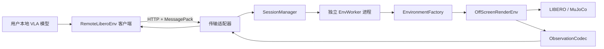
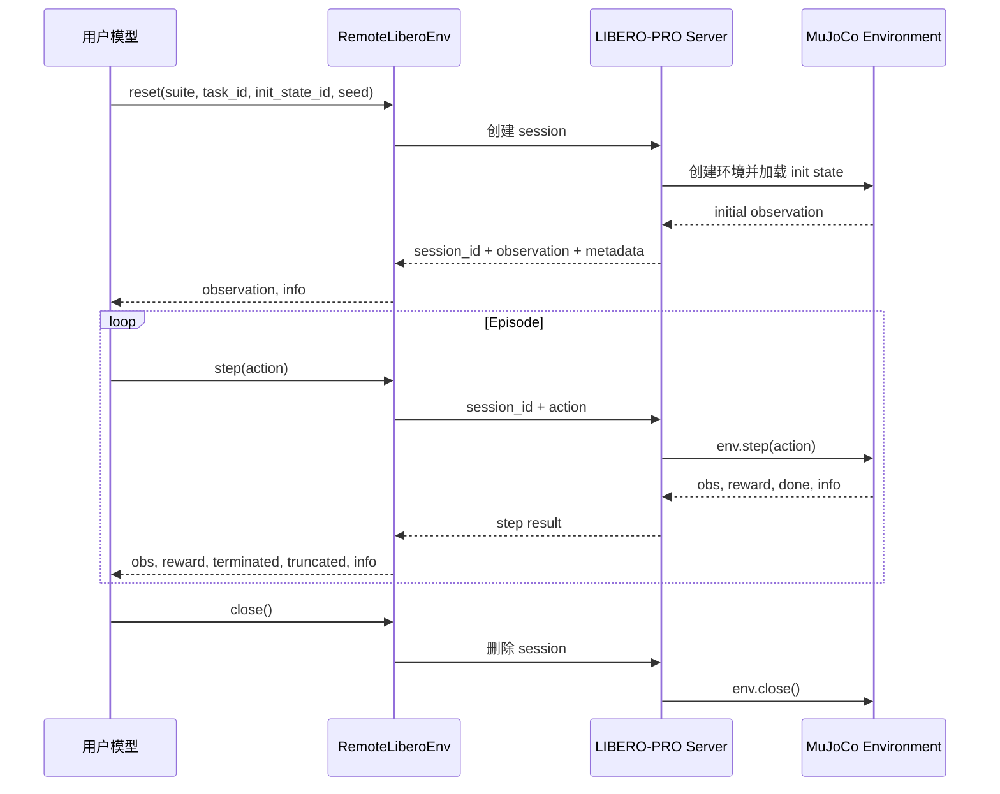

# LIBERO-PRO Remote Evaluation Service

> 状态：1.0.0 发布版本
> 当前阶段：Docker 与 Conda 离线部署包已完成本地验收，支持 1680 项 manifest 任务和多账户服务

## 1. 当前任务

将 LIBERO-PRO 从“用户下载代码和数据后在本地部署”的评测方式，改造成一个可远程调用的环境评测服务：

- LIBERO、MuJoCo、BDDL、初始状态和扰动规则都运行在服务端。
- 用户的 VLA 模型运行在用户本地。
- 服务端向用户返回 observation，用户模型计算 action 后再发回服务端。
- 服务端执行 action，推进环境并返回下一步 observation、reward、终止状态和成功状态。
- 客户端保持接近 Gym 环境的调用体验，只需要使用 `reset()`、`step()` 和 `close()`。

仓库已经实现协议、独立环境 worker、session 生命周期、HTTP 服务、Python 客户端、任务
manifest、静态/动态扰动运行时和多账户调度。代码可以使用确定性的 `fake` 后端完成本地
端到端验证；部署到 Linux/NVIDIA 服务器后使用默认的 `libero` 后端执行真实 MuJoCo/EGL 评测。

## 快速验证

开发环境使用 Python 3.8，以保持与 LIBERO-PRO 的运行环境一致：

```bash
python3.8 -m venv .venv
source .venv/bin/activate
python -m pip install -e ".[dev]"

LIBERO_REMOTE_BACKEND=fake \
LIBERO_REMOTE_HOST=0.0.0.0 \
libero-remote-server
```

另一个终端执行：

```bash
curl http://127.0.0.1:8000/v1/health
python scripts/server_smoke_test.py --base-url http://127.0.0.1:8000
```

`fake` 后端不依赖 LIBERO、MuJoCo 或 GPU，只用于验证网络、数组编解码、请求顺序和
资源清理，不能替代真实评测结果。

## 服务器部署

Docker 服务器需要 NVIDIA 驱动和 NVIDIA Container Toolkit；客户端机器只需要 Python 包，
不需要安装 LIBERO 或 MuJoCo。`model-agnostic-multiuser` 分支包含完整的
`simulator-source/`；该目录有 2,536 个固定提交的模拟器文件，其中大文件由 Git LFS
管理。首次 clone 后必须执行 `git lfs pull`，确认 LFS 实体已经下载，再将该分支作为
Docker build context。无网络或不使用 Git LFS 时，请使用包含相同源码的
`libero-pro-conda-bundle-1.0.0.tar.gz` 离线交付包；维护者若需重建 Docker 包，必须让
`scripts/build_customer_bundle.ps1` 从本地 `LIBERO-PRO@c02ee2c` 导出完整 runtime。

```bash
tar -xzf libero-pro-bundle-1.0.0.tar.gz
cd libero-pro-bundle-1.0.0
bash install.sh
docker compose ps
docker compose logs -f libero-remote
```

镜像和 Conda 离线包固定使用 `LIBERO-PRO` 的 commit
`c02ee2c8255db1c36664fad978197c47e495f178`，并安装 Python 3.8、锁定的 PyTorch、
robosuite、MuJoCo 和本服务。当前发布的 1680 个 LIBERO-PRO BDDL 位于
`assets/bddl/libero-pro2.0-1680-v1/` 并进入镜像；`assets/bddl/00_original/bddl`
仅作为历史基线保留，不属于发布 manifest。init state 仍从固定的 LIBERO-PRO commit 加载。

启动后先检查廉价就绪探针：

```bash
curl http://SERVER_IP:8000/v1/health
curl http://SERVER_IP:8000/v1/tasks
```

非 Docker 部署不要在线 clone `LIBERO-PRO` 或自行解析依赖。下载服务仓库 release
[`v1.0.0-conda-r2`](https://github.com/Zxy-MLlab/LIBERO-Pro2.0/releases/tag/v1.0.0-conda-r2)
中的 `libero-pro-conda-bundle-1.0.0.tar.gz` 及其 SHA-256 清单，按
`deploy/customer-conda/README.md` 安装；该包同时包含固定服务源码、完整模拟器源码、1680 项
BDDL、init states 和锁定依赖。该离线包中的 `simulator-source/` 与本分支 Git LFS
checkout 内容逐文件一致。

再从另一台机器运行一次真实环境 smoke test：

```bash
git clone --branch model-agnostic-multiuser https://github.com/Zxy-MLlab/LIBERO-Pro2.0.git
cd LIBERO-Pro2.0
python3.8 -m venv .venv
source .venv/bin/activate
python -m pip install .
python scripts/server_smoke_test.py --base-url http://SERVER_IP:8000
```

smoke test 会真实执行 `health -> create/reset -> step -> close`。只有它通过，才能说明
服务器上的 LIBERO 数据、MuJoCo、EGL、NVIDIA runtime 和 session 清理链路同时可用。

### 部署约束

- 生产 Compose 默认启用 API key、结果签名和账户隔离；仍只能放在可信内网、VPN 或 SSH 隧道后，不能直接暴露公网。
- Uvicorn 必须保持单 API 进程。每个 session 已有独立 `spawn` worker，不能再用多个
  Uvicorn worker 分割内存中的 session registry。
- `LIBERO_REMOTE_MAX_SESSIONS` 默认是 `1`；提高前先测量单环境 GPU 显存和主存。
- `step` 超时后不要生成新 `request_id` 盲目重试；用原 `request_id` 安全重放。
- `/v1/health` 只检查进程、基础数据目录和容量；真实渲染是否可用由 smoke test 验证。

### 主要配置

| 环境变量 | 默认值 | 作用 |
| --- | ---: | --- |
| `LIBERO_REMOTE_PUBLIC_PORT` | `8000` | Compose 暴露的服务器端口 |
| `LIBERO_REMOTE_MAX_SESSIONS` | `1` | 同时占用环境资源的 session 上限 |
| `LIBERO_REMOTE_WORKER_TIMEOUT_SECONDS` | `120` | 单次 worker 命令超时；超时后 worker 被终止 |
| `LIBERO_REMOTE_SESSION_IDLE_TIMEOUT_SECONDS` | `900` | session 空闲回收时间 |
| `LIBERO_REMOTE_CLEANUP_INTERVAL_SECONDS` | `30` | 后台扫描空闲 session 的间隔 |
| `LIBERO_REMOTE_BDDL_ROOT` | `assets/bddl/libero-pro2.0-1680-v1` | 服务端当前使用的 1680 项发布 BDDL 根目录 |
| `NVIDIA_VISIBLE_DEVICES` | `all` | 容器可见 GPU；生产环境建议指定设备 |
| `LIBERO_PRO_COMMIT` | 固定 commit | 构建时使用的 LIBERO-PRO 版本 |

## 代码作用

| 路径 | 作用 |
| --- | --- |
| `libero_remote/protocol/models.py` | 定义协议版本、请求字段、状态和稳定错误码 |
| `libero_remote/protocol/codec.py` | 用 MessagePack 无损编解码 NumPy dtype、shape 和原始字节 |
| `libero_remote/environment/` | 统一真实 LIBERO 与测试后端的 `create/reset/step/close` 接口 |
| `libero_remote/environment/libero.py` | 查找 suite/task/init state 并包装 `OffScreenRenderEnv` |
| `libero_remote/environment/observations.py` | 白名单化并规范两路图像和机器人本体状态 |
| `libero_remote/environment/readiness.py` | 不初始化 MuJoCo 的后端与基础数据就绪检查 |
| `assets/bddl/` | 保存历史基线和当前 1680 个已发布 BASE/static/dynamic BDDL |
| `libero_remote/worker/process.py` | 用 `spawn` 子进程隔离 MuJoCo/EGL，并处理超时和强制回收 |
| `libero_remote/server/session.py` | 保存单个 session 的 episode、step、锁和幂等缓存 |
| `libero_remote/server/session_manager.py` | 管理容量、顺序、幂等、失败、空闲过期和全局关闭 |
| `libero_remote/server/app.py` | FastAPI 路由、MessagePack 响应、错误映射和后台清理任务 |
| `libero_remote/server/settings.py` | 将环境变量转换为经过校验的服务配置 |
| `libero_remote/client/` | 提供 Gym 风格客户端、HTTP 连接复用和稳定异常类型 |
| `scripts/server_smoke_test.py` | 从客户端机器验证真实服务器完整交互链路 |
| `Dockerfile` / `compose.yaml` | 固定服务器依赖并以单 API 进程、GPU/EGL 模式启动 |
| `tests/` | 覆盖协议、worker 状态保持、session 幂等/回收和端到端调用 |

## 开发质量检查

```bash
python -m pytest -q
python -m mypy libero_remote
python -m ruff check libero_remote tests scripts
```

## 2. 背景

当前 LIBERO-PRO 的使用流程包含以下成本：

1. 用户需要下载 LIBERO-PRO 仓库、BDDL 文件和 init state 文件。
2. 用户需要安装指定版本的 Python、PyTorch、robosuite 和 MuJoCo。
3. 用户需要修改自己的模型评测代码来接入新增任务集。
4. 不同用户的本地环境差异容易造成安装失败或评测结果不可复现。
5. 静态 BDDL 文件公开后，模型可以直接基于评测任务收集数据并进行针对性训练。
6. 本地运行时，LIBERO-PRO 无法统一控制 episode 中途发生的动态扰动。

远程评测服务将环境和规则集中在服务器上，降低接入成本，同时为静态扰动、动态扰动、统一日志和后续排行榜提供一个稳定入口。

## 3. 总体路线

项目分四个阶段推进：

| 阶段 | 目标 | 本阶段是否实现 |
| --- | --- | --- |
| 第一阶段 | 原始 LIBERO 环境远程化，内网单用户打通完整交互链路 | 已完成 |
| 第二阶段 | 接入已发布静态扰动，允许用户选择评测类型 | 已完成 |
| 第三阶段 | 接入已发布运行时动态扰动，由服务端按规则触发 | 已完成 |
| 第四阶段 | 公网部署、并发调度、鉴权、限流、监控和排行榜 | 部分完成 |

当前发布已覆盖服务闭环、1680 项任务、固定 seed 复现、失败重试、多账户隔离和运行时扰动；公网运营和生产级监控仍需按部署环境单独配置。

## 4. 服务目标

当前发布需要保证下面这条链路可复现：

1. 用户在内网客户端创建指定的 LIBERO task。
2. 服务端创建一个独立环境实例并加载指定 init state。
3. 服务端把图像、机器人本体状态和任务信息传给客户端。
4. 客户端返回一个 action 向量。
5. 服务端执行 `env.step(action)`，返回下一步结果。
6. episode 成功、超出步数或客户端主动结束后，服务端释放环境。

### 当前发布范围

- 支持 `libero_goal`、`libero_spatial`、`libero_object` 和 `libero_10`。
- 支持按 `suite + task_id + init_state_id + seed` 创建环境。
- 支持两路默认相机图像和机器人本体状态。
- 支持多账户并发、单账户活动 session 配额和串行 step。
- 支持环境超时回收和显式关闭。
- 提供一个 Python 客户端包，隐藏网络协议和数组编解码细节。

### 当前发布暂不包含

- 计费、公开排行榜和公网运营。
- 用户模型托管和服务端模型推理。
- 训练数据下载或世界模型训练。
- Web 管理后台。

## 5. 系统架构



设计重点是把复杂度放在服务端模块内部。调用方只学习一个很小的客户端接口，不需要知道 BDDL 路径、MuJoCo 状态、图像数组序列化或环境资源清理方式。

### 核心模块

| 模块 | 职责 |
| --- | --- |
| `RemoteLiberoEnv` | 向模型代码提供类似 Gym 的客户端接口 |
| 传输适配器 | 校验 HTTP 请求，将请求交给会话模块，并编码响应 |
| `SessionManager` | 管理环境生命周期、调用顺序、超时和资源释放 |
| `EnvWorker` | 在独立 spawn 进程中隔离 MuJoCo/EGL 环境和故障 |
| `EnvironmentFactory` | 根据 task 描述创建并初始化 LIBERO 环境 |
| `ObservationCodec` | 筛选 observation 字段并编解码 NumPy 数组 |
| `TaskCatalog` | 枚举允许调用的 suite、task 和 action/observation 元数据 |

任务 manifest 通过 `base`、`S01-S21`、`D01-D19` 和 `D21` case id 选择已发布 BDDL。固定运行时同时提供
`set_perturbation_seed`、`begin_perturbation_rollout` 和 `get_perturbation_plan`，并在就绪检查中拒绝缺少这些能力的旧模拟器。

## 6. 交互流程



环境按请求推进，不依赖真实时间连续运行。因此客户端模型推理耗时只会增加评测墙钟时间，不会让机器人在等待期间自行运动。

## 7. 客户端接口

用户侧只暴露以下主要接口：

```python
from libero_remote import RemoteLiberoEnv

env = RemoteLiberoEnv(
    base_url="http://10.0.0.8:8000",
    timeout=60.0,
)

obs, info = env.reset(
    suite="libero_goal",
    task_id=9,
    init_state_id=0,
    seed=142,
)

terminated = False
truncated = False

while not (terminated or truncated):
    action = model.predict(obs, instruction=info["language_instruction"])
    obs, reward, terminated, truncated, info = env.step(action)

env.close()
```

接口约束：

- 第一次 `reset()` 创建服务端 session。
- 一个 session 同一时刻只允许一个在途请求。
- `action` 必须匹配服务端返回的 action shape 和 dtype。
- episode 结束后必须再次 `reset()` 或调用 `close()`。
- 客户端上下文管理器退出时自动调用 `close()`。
- 网络超时不应自动重试 `step()`，否则同一个 action 可能执行两次。客户端需要使用 `request_id` 查询或安全重放。

## 8. HTTP 接口

服务使用 FastAPI 提供同步请求响应接口。控制信息使用普通 JSON；包含 observation 的响应使用 `application/x-msgpack`，以便直接传输 NumPy 字节数据。

| 方法 | 路径 | 用途 |
| --- | --- | --- |
| `GET` | `/v1/health` | 进程和环境依赖健康检查 |
| `GET` | `/v1/tasks` | 获取可用 suite、task 和空间元数据 |
| `POST` | `/v1/sessions` | 创建环境 session |
| `POST` | `/v1/sessions/{id}/reset` | 重置当前环境 |
| `POST` | `/v1/sessions/{id}/step` | 执行一个 action |
| `GET` | `/v1/sessions/{id}` | 查询 session 状态和最后一个 request id |
| `DELETE` | `/v1/sessions/{id}` | 关闭环境并释放资源 |

### 创建 session

```json
{
  "protocol_version": "1.0",
  "suite": "libero_goal",
  "task_id": 9,
  "init_state_id": 0,
  "seed": 142,
  "variant": "base",
  "control_mode": "relative",
  "camera_names": ["agentview", "robot0_eye_in_hand"],
  "camera_height": 128,
  "camera_width": 128,
  "max_steps": 300
}
```

`variant` 接受 `base`、`S01-S21`、`D01-D19` 和 `D21`；可用的 suite/task/variant 组合以
`/v1/tasks` 返回的 1680 项 manifest 为准。

创建成功后返回：

```json
{
  "session_id": "01J...",
  "status": "ready",
  "suite": "libero_goal",
  "task_id": 0,
  "language_instruction": "put the bowl on the plate",
  "action_space": {
    "shape": [7],
    "dtype": "float32",
    "low": [-1, -1, -1, -1, -1, -1, -1],
    "high": [1, 1, 1, 1, 1, 1, 1]
  },
  "observation_space": {
    "agentview_image": {"shape": [128, 128, 3], "dtype": "uint8"},
    "robot0_eye_in_hand_image": {"shape": [128, 128, 3], "dtype": "uint8"}
  }
}
```

实际 action 维度和范围必须从创建后的环境读取，不能只在协议里硬编码为 7。

### 执行 step

```json
{
  "request_id": "episode-1-step-17",
  "action": [0.01, -0.02, 0.0, 0.1, 0.0, 0.0, 1.0]
}
```

逻辑响应为：

```text
protocol_version: "1.0"
request_id: "episode-1-step-17"
session_id: "01J..."
step_index: 17
observation: map<string, ndarray>
reward: float32
terminated: bool
truncated: bool
success: bool
info: map<string, scalar>
```

`terminated` 表示任务成功或环境自身结束；`truncated` 表示达到服务端配置的最大步数。不能把这两种结束原因合并成一个含义不明确的 `done`。

### 错误语义

| 状态码 | 场景 |
| --- | --- |
| `400` | action shape、dtype 或参数非法 |
| `404` | suite、task 或 session 不存在 |
| `409` | session 状态不允许当前操作，或已有 step 正在执行 |
| `410` | session 已超时并被回收 |
| `422` | 请求结构不符合协议 |
| `500` | LIBERO/MuJoCo 内部错误 |
| `503` | 服务端暂时没有可用环境资源 |

错误响应必须包含稳定的 `error_code`、可读消息和 `request_id`，客户端逻辑不能依赖错误字符串。

## 9. Observation 编码

服务不使用 Base64，也不默认使用 JPEG。Base64 会额外增加约三分之一体积；JPEG 的有损压缩可能改变模型输入并影响评测公平性。

每个 NumPy 数组编码为：

```text
{
  "dtype": "uint8",
  "shape": [128, 128, 3],
  "data": <raw bytes>
}
```

要求：

- 数组统一转换为 C-contiguous。
- 协议中显式携带 dtype、shape 和字节序。
- 客户端解码后保持与服务端 observation 相同的键名。
- 只传输白名单字段，不直接序列化 LIBERO 返回的任意 Python 对象。
- `info` 中只允许标量、短字符串和受控的小型数组。
- 不对图像做转置、翻转、归一化或颜色空间转换；这些属于用户模型适配逻辑。

两路 `128 x 128 x 3` 的 `uint8` 图像每步约 96 KiB。即使每秒执行 20 step，单 session 的原始图像带宽约为 15 Mbit/s；压缩策略应在测量真实吞吐后决定。

## 10. Session 生命周期

```text
CREATING -> READY -> RUNNING -> TERMINATED
               ^         |
               |---------| reset

任意非 CLOSED 状态 -> CLOSED
长时间无请求       -> EXPIRED
内部不可恢复错误   -> FAILED
```

`SessionManager` 必须保证：

- 每个 session 只拥有一个环境实例。
- 同一 session 的操作严格串行。
- 每个成功 step 只递增一次 `step_index`。
- 重复的 `request_id` 返回缓存结果，不能重复执行 action。
- session 超时或失败后一定调用 `env.close()`。
- 进程退出时关闭全部环境。
- 响应日志记录 suite、task、step、耗时和结果，但不记录完整图像。

当前实现为每个 session 启动独立 `spawn` worker。FastAPI 进程只保存
session 元数据、进程句柄和请求缓存，不直接导入或持有 MuJoCo 环境。

## 11. 与现有 LIBERO-PRO 的连接方式

当前仓库已经具备发布所需的核心能力：

- `libero/libero/benchmark/__init__.py` 可以按 suite 和 task id 查找 BDDL 与 init state。
- `libero/libero/envs/env_wrapper.py` 中的 `OffScreenRenderEnv` 已提供 `reset()`、`step()`、`set_init_state()` 和 `close()`。
- `OffScreenRenderEnv.sim` 暴露底层 MuJoCo simulation，固定 runtime 已用于动态扰动。
- `simulator-source/libero/libero/envs/` 提供固定扰动配置解析、静态/动态运行时和扰动计划接口。

环境创建实现可按以下流程完成：

```python
from libero.libero import benchmark
from libero.libero.envs import OffScreenRenderEnv


def create_environment(spec):
    suite_cls = benchmark.get_benchmark_dict()[spec.suite]
    suite = suite_cls()

    task = suite.get_task(spec.task_id)
    bddl_path = suite.get_task_bddl_file_path(spec.task_id)
    init_states = suite.get_task_init_states(spec.task_id)

    env = OffScreenRenderEnv(
        bddl_file_name=bddl_path,
        camera_names=spec.camera_names,
        camera_heights=spec.camera_height,
        camera_widths=spec.camera_width,
    )
    env.seed(spec.seed)
    env.reset()
    observation = env.set_init_state(init_states[spec.init_state_id])

    return env, task, observation
```

实际实现还需要校验 task id、init state id、相机配置、action space 和异常清理。

## 12. 推荐代码结构

```text
libero_remote/
  __init__.py
  protocol/
    models.py              # 请求、响应和错误模型
    codec.py               # NumPy / MessagePack 编解码
  environment/
    task_catalog.py        # suite 和 task 查询
    factory.py             # 创建并初始化 OffScreenRenderEnv
    adapter.py             # 统一 reset/step/close 的环境接口
  server/
    app.py                 # FastAPI 入口和传输适配器
    session.py             # Session 状态和值对象
    session_manager.py     # 生命周期、幂等、超时和清理
    settings.py            # 服务端配置
  client/
    remote_env.py          # 用户侧 Gym 风格接口
    transport.py           # HTTP keep-alive、超时和错误映射

tests/
  unit/
    test_codec.py
    test_session_manager.py
    test_protocol_models.py
  integration/
    test_environment_factory.py
    test_server_client_roundtrip.py
    test_local_remote_equivalence.py
```

不建议直接在 `env_wrapper.py` 中加入 HTTP 逻辑。环境代码只负责仿真，网络和会话逻辑放在新模块中，避免影响原有本地评测方式。

## 13. 技术选型

| 领域 | 当前发布选择 | 原因 |
| --- | --- | --- |
| 服务框架 | FastAPI + Uvicorn | Python 接入简单，便于内网原型和接口校验 |
| 客户端 | `httpx.Client` | 支持连接复用、超时和明确的同步语义 |
| 数据协议 | MessagePack | 可传原始二进制，体积明显小于 Base64 JSON |
| 数组表示 | NumPy raw bytes + dtype + shape | 可无损恢复 observation |
| session id | UUIDv7/ULID | 不暴露递增用户数量且便于日志排序 |
| 配置 | YAML + 环境变量覆盖 | 与现有 LIBERO-PRO 配置方式相容 |
| 测试 | pytest | 适合协议、模块和端到端测试 |

当前交付包使用 Python 3.8.10，并锁定 FastAPI、Pydantic、httpx、PyTorch、robosuite、MuJoCo 和渲染依赖；如果后续升级 Python，需要先验证依赖和渲染行为是否一致。

## 14. 发布实施步骤

### 里程碑 1：协议和编解码

- 已定义 session、task、step 和错误模型。
- 已实现 NumPy/MessagePack 编解码。
- 已完成 dtype、shape、非法数据和往返一致性测试。

### 里程碑 2：本地环境模块

- 已实现 `TaskCatalog` 和 `EnvironmentFactory`。
- 已支持用 `suite + task_id + init_state_id + seed + variant` 创建环境。
- 已验证 `reset -> step -> close` 在无网络和远程服务中正常工作。

### 里程碑 3：服务端 session

- 已实现 session 状态机和操作串行化。
- 已实现 request id 幂等保护。
- 已实现超时回收、异常清理和健康检查。

### 里程碑 4：HTTP 传输与客户端

- 已实现所有 `/v1` 路径。
- 已实现 `RemoteLiberoEnv`。
- 已将 HTTP 错误映射成稳定的 Python 异常类型。

### 里程碑 5：内网端到端验证

- 已提供服务端和客户端跨机器运行方式。
- 已用固定 seed、init state 和 action 序列完成复现验收。
- 已记录运行时、任务和结果指纹，并验证环境释放。
- 已提供最小用户接入示例。

## 15. 验收标准

当前发布验收包含：

1. 客户端可以查询可用 task，并创建指定环境。
2. 客户端能收到两路图像、机器人状态和语言指令。
3. 客户端可以连续执行至少 300 个 step，step 顺序无错乱、无重复。
4. `terminated`、`truncated` 和 `success` 含义明确且结果正确。
5. 相同 seed、init state 和 action 序列下，本地与远程状态向量在约定误差内一致。
6. observation 经编解码后 dtype、shape 和原始字节保持一致。
7. 非法 action、错误 task 和过期 session 返回稳定错误码。
8. 正常结束、客户端断开、超时和内部异常都不会遗留环境实例。
9. 连续创建并关闭 100 次环境后，服务进程内存和显存没有持续增长。
10. 客户端示例代码不需要导入 LIBERO、MuJoCo 或读取 BDDL 文件。

图像一致性应区分两类测试：同一个 observation 的协议往返必须逐字节一致；两个独立 MuJoCo 实例的渲染结果可根据实际硬件设定像素误差阈值。

## 16. 静态扰动

创建 session 时使用已发布 manifest 的 `variant`：

```text
base
S01-S21
D01-D19
D21
```

服务端根据 `variant` 从 1680 项 manifest 选择对应 BDDL/init state 集合，并在固定运行时中执行静态或动态扰动。
客户端只选择已发布的 case id，不接触 BDDL 文件和扰动配置。

需要明确：把 BDDL 留在服务端只能提高直接获取和针对性训练的成本，不能从理论上彻底阻止通过大量查询推断评测分布。因此还需要访问配额、隐藏测试集轮换和异常查询检测。

## 17. 动态扰动

动态扰动在服务端的 `step` 流程中触发：

```text
校验 action
  -> before_step 规则
  -> env.step(action)
  -> after_step 规则
  -> sim.forward()
  -> 重新生成 observation
  -> 返回结果
```

可能包含：

- 运动和交互类事件依据运行时状态触发，例如末端与目标/关节锚点的距离、目标的抬升或平面位移、夹爪闭合、运输/放置阶段和任务阶段；首次触发不依赖固定 rollout 步数。
- 改变物体姿态、机器人初始位置或相机参数。
- 改变光照强度、方向、眩光和遮挡。
- 触发后的持续时间、恢复窗口和扰动幅度由 case 参数与可复现的私有 seed 决定，并记录实际触发 step。

动态扰动会记录内部审计事件，并通过固定 seed、扰动计划指纹和结果回执保证可复现；普通客户端只接收协议要求的计划摘要和结果字段。

## 18. 风险与处理

| 风险 | 处理方式 |
| --- | --- |
| MuJoCo 渲染上下文不是线程安全的 | 同一 session 严格串行；并发阶段采用独立 worker 进程 |
| step 超时后客户端重试导致动作执行两次 | 每个 step 携带唯一 `request_id`，服务端缓存最近结果 |
| 图像负载导致延迟或带宽过高 | 先测量原始数据；后续再增加可协商的无损压缩 |
| 服务崩溃遗留 GPU/环境资源 | `try/finally` 清理、超时回收、进程退出钩子和 worker 隔离 |
| 不同服务器版本产生评测差异 | 固定镜像、依赖 lock、代码 commit、任务版本和 seed |
| 用户访问任务过多导致信息泄漏 | 使用 API key、账户配额、manifest 白名单和审计记录 |
| 旧依赖限制服务框架版本 | 交付包固定 Python 3.8 依赖，升级单独验证 |

## 19. 待评审问题

当前部署前需要确认：

1. 目标主机是否满足 NVIDIA 驱动、EGL 和 Docker/Conda 部署前置条件？
2. 运行 Docker 还是 `v1.0.0-conda-r2` 离线包？
3. 是否按 `/v1/tasks` 选择已发布的 suite、task 和 variant 组合？
4. 客户端是否固定相同的 init state、seed、模型、processor 和动作序列？
5. 是否为每个账户单独生成并保管 API key 和客户端配置？
6. 单账户和服务器总活动 session 配额是否匹配 GPU 显存与主存？
7. 是否保留 smoke、结果回执和审计记录用于复测？
8. 真实评测是否在 smoke 与一致性验收通过后开始？

## 20. 当前发布成果

当前发布提供：

- 一个可在内网启动的 LIBERO-PRO server。
- 一个可独立安装的轻量 Python client。
- 一份协议说明和用户调用示例。
- 一套单元测试、集成测试和本地/远程一致性测试。
- 一份内网端到端演示记录及性能基线。
- 一份部署、复测和失败重试的验收记录。

当前发布的成功标准是用固定任务、seed 和运行时完成可复现的远程 `reset/step/close`，并保证任务 manifest、账户隔离、失败重试和环境资源清理一致。

## 21. 用户模型 Adapter 与参考 runner

平台不固定 xVLA，但这不意味着所有模型共用同一个 adapter 实现。正式边界是模型无关的
`AgentAdapter` 接口和版本化标准 observation/action；每种模型仍需实现自己的轻量专用 adapter，将通用字段
映射为该模型实际需要的输入和输出。服务端负责环境调度、隔离、确定性初态和权威结果。完整契约见
`docs/model-adapter-contract.md`。

xVLA 和 Pi0 runner 只用于展示两个不同模型如何复用同一服务端协议，不是模型白名单，服务端也不加载其依赖。
通用 `libero_remote.runner` 入口不导入任何参考模型；需要示例实现时再从对应的 `runner.xvla` 或
`runner.pi0` 子模块显式导入。

Pi0 和 xVLA 的 direct runner 都可以将远程 observation 中的相机帧保存为每个 episode 一个 MP4。
先在模型环境安装 `pip install -e ".[video]"`，然后给对应 Python runner 增加
`--record-video`。默认记录 `agentview`、20 FPS；可通过 `--video-camera robot0_eye_in_hand`、
`--video-fps` 和 `--video-dir` 调整。录像默认关闭，不影响未启用录像的运行环境。

```bash
python scripts/run_pi0_remote_eval.py ... --record-video --video-dir results/pi0_videos
python scripts/run_xvla_remote_eval.py ... --record-video --video-dir results/xvla_videos
```

文件名包含模型、suite、task、variant、seed 和 init state，避免多 episode 结果互相覆盖。

评估架构采用“通用运行层 + 模型专用 adapter”：任务配置、标准 observation/action、环境交互、任务队列、
复现信息、录像与结果记录、协议校验和一致性验收复用通用实现；模型专用 adapter 则负责该模型自己的图像与
语言输入映射、prompt/tokenizer、proprio 与坐标系转换、官方 processor、推理状态或 action chunk，以及 action
反归一化、控制语义转换和协议范围收口。xVLA 与 Pi0 因模型约定不同，必须使用各自的 adapter，不能把
`pixels`、`robot_state` 或其他模型专用字段放进通用 adapter。接入新模型时，应按照
`docs/model-adapter-contract.md` 新增该模型的专用 adapter；通常无需修改服务端或通用 runner。

通用评估提供两种运行模式：

- `Scheduled Runner`：先用 `RemoteRunClient.submit_run()` 提交一个或多个 episode，再用
  `run_scheduled_run()` 领取任务。runner 为每个 episode 建立 lease，在模型推理期间独立发送 heartbeat，
  按顺序执行 observation/action/step，完成后提交服务端权威结果，再继续领取下一个任务。该模式覆盖任务队列、
  多用户隔离、并发配额、基础设施失败回收与重试、任务进度持久化和复现指纹校验，建议用于正式批量评估和复测。
- `Direct Runner`：用 `AgentEpisodeSpec` 描述一个 episode，调用 `run_remote_agent_episode()` 直接
  `reset` 远程环境、逐 step 调用 adapter、读取服务端结果并关闭 session。该模式不经过任务队列和 lease 调度，
  适合单任务 smoke test、本地调试和快速验证 adapter 的 observation/action 映射；它不提供 Scheduled Runner
  的批量调度、跨用户公平性和调度器级失败重试。模型专用 direct runner（例如 xVLA 的参考循环）也属于这一类，
  仅用于展示模型处理流程，不应替代通用评估入口。

在 Scheduled Runner 之上，`libero_remote.benchmark` 和 `scripts/run_grouped_eval.py` 提供分组式多 seed
计划。它们直接读取 `/v1/tasks`，支持按 `base/static/dynamic/all`、suite 和 case 选择已发布任务，按
一一对应或显式矩阵方式展开 seed 与 init state，并将整个计划提交为一个可恢复的 run。结果可导出为
JSONL、CSV 和按 suite/variant/group/seed 汇总的 JSON。该层不识别或加载具体模型；已经构造 adapter 的
runner 可调用 `run_grouped_benchmark()` 一次执行计划中的剩余 rollout。完整用法见
`docs/grouped-benchmark.md`。

### 21.1 本机 xVLA 参考 runner

计算分工保持不变：xVLA 权重和 CUDA 推理在本机 WSL 中运行，LIBERO、MuJoCo、BDDL 和两路相机渲染在服务器运行。每个 step 只通过 SSH 隧道传输 observation 和 7 维 action。

本机默认路径：

```text
xVLA 模型: D:\models\xvla-libero
BART tokenizer: D:\models\facebook-bart-large-tokenizer
LeRobot: D:\lerobot
WSL Python: /home/vla/venvs/lerobot-xvla312/bin/python
```

WSL 的 xVLA 环境需要远程客户端依赖：

```powershell
wsl.exe -d Ubuntu -- /home/vla/venvs/lerobot-xvla312/bin/python -m pip install "msgpack==1.0.8" "httpx==0.24.1"
```

从 PowerShell 一键启动：

```powershell
Set-Location D:\LIBERO-Pro2.0\.claude-manager\worktrees\task-build-platform
.\scripts\Start-XvlaRemoteEval.ps1 `
  -Suite libero_goal `
  -TaskId 9 `
  -InitStateId 0 `
  -Episodes 1 `
  -Seed 142 `
  -MaxSteps 300
```

启动脚本先从 WSL 检查远程健康状态。若 `172.x.x.x:18082` 不可用，它会在 Windows 后台建立
`WSL gateway:18082 -> server 127.0.0.1:8000` 的 SSH 隧道；只有由本次命令创建的隧道才会在评测结束后关闭。

多 episode 运行时，第 `n` 个 episode 使用 `init_state_id + n` 和 `seed + n`。每次启动 runner 时，先向
`results/xvla_remote_eval.jsonl` 追加一条 `run_manifest`，再逐 episode 追加 `episode_result`。两类记录都使用
`report_schema_version="1.0"`。运行清单固化服务端 runtime、客户端与 LeRobot commit、Python/OS/GPU、模型及
tokenizer 目录的 SHA-256，以及 suite、task、seed、步数和控制模式；episode 结果记录 reward、success、结束原因和耗时。

主要文件职责：

| 文件 | 作用 |
| --- | --- |
| `libero_remote/runner/xvla.py` | observation 映射、LeRobot/xVLA 预处理与后处理、episode 循环、资源关闭、结果模型 |
| `scripts/run_xvla_remote_eval.py` | WSL 中运行的命令行入口，加载一次模型并执行一个或多个 episode |
| `scripts/Start-XvlaRemoteEval.ps1` | Windows 入口，检查/建立 SSH 隧道、转换 WSL 路径并启动 Python runner |
| `libero_remote/runner/report.py` | 收集客户端/服务端运行环境并计算模型与 tokenizer 文件树哈希 |
| `libero_remote/protocol/models.py` | 声明并校验 `relative` / `absolute` 控制模式 |
| `libero_remote/environment/libero.py` | 服务器端设置 `controller.use_delta`，并返回与控制模式匹配的 action schema |
| `tests/test_xvla_runner.py` | 验证 observation 映射、处理顺序、动作校验、session 清理和 JSONL 输出 |

xVLA 必须使用 `control_mode="absolute"`。runner 会检查服务端返回的 action schema；旧服务若静默忽略该参数，评测会立即失败，不会用错误的动作语义继续运行。因此首次端到端测试前，需要先部署匹配版本。部署动作本身不自动启动服务；执行 smoke test、一致性验收或模型评测前，由操作者显式启动 `libero-remote.service`，测试结束后可再次停止。

## 22. SOP 一致性验收与审计格式

服务端审计日志采用单行 JSON，`audit_schema_version="1.0"`。当前覆盖 `session_created`、
`session_reset`、`step_committed`、`step_replayed`、`step_rejected`、`worker_failed`、
`session_expired`、`session_closed` 和 `environment_creation_failed`。日志只记录 session/episode/request 标识、
step、action SHA-256、耗时、结果、错误码和清理原因，不记录完整 action 或 observation。

SOP 第 8 节的三层验收由下面的命令执行。该命令需要在能够直接创建 LIBERO 环境的 Linux/NVIDIA 环境中运行；
它同时连接已启动的远程服务，并用相同 task、init state、seed 和固定 action 序列创建一个独立本地环境：

```bash
python scripts/validate_local_remote_equivalence.py \
  --base-url http://127.0.0.1:8000 \
  --local-backend libero \
  --suite libero_goal \
  --task-id 9 \
  --init-state-id 0 \
  --seed 142 \
  --control-mode relative \
  --steps 10 \
  --output results/local_remote_equivalence.json
```

未传 `--actions` 时使用固定的全零 `float32` action 序列；也可传入二维 JSON 数组。报告使用
`equivalence_report_schema_version="1.0"`，记录 action 序列哈希和以下结果：

1. MessagePack 往返后的键、dtype、shape、C-contiguous layout 和原始字节是否一致。
2. 远程 observation 映射为 xVLA/LeRobot 输入后，五个源数组是否逐元素一致。
3. 两个独立环境每一步的 reward、success、terminated/truncated、step index、状态误差，以及图像最大/平均绝对误差和不一致像素比例。

真实环境首次验收默认要求图像逐像素一致。若硬件或渲染栈确实产生可解释差异，必须通过
`--image-max-abs`、`--image-mean-abs` 和 `--image-mismatch-ratio` 显式声明阈值，并把阈值保留在报告中；
不能在代码里静默放宽。`/v1/health` 仍只表示进程、依赖和数据目录就绪，不能替代 smoke test 或该一致性验收。
