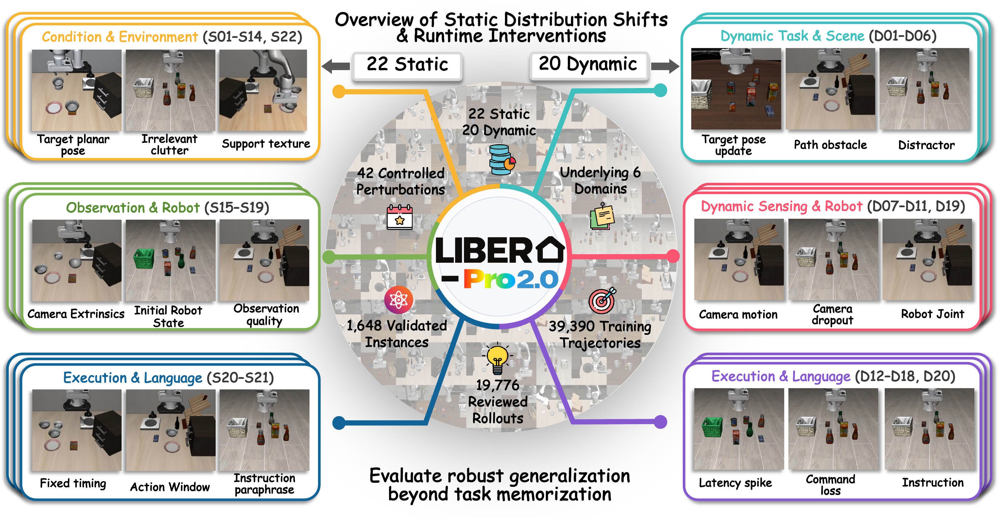
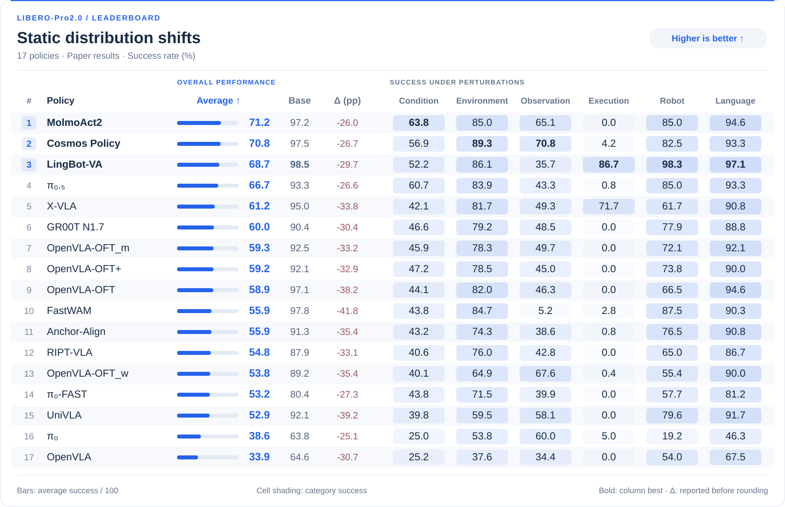
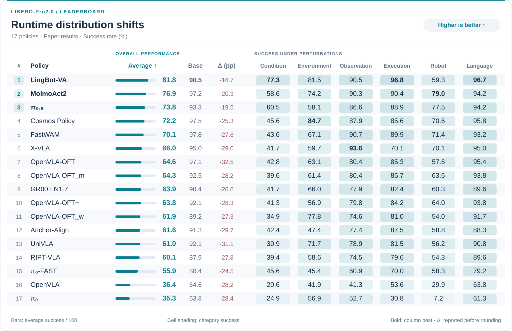

<h1 align="center">
LIBERO-Pro2.0: A Benchmark for Evaluating<br>
the Robustness of Embodied Foundation Models
</h1>

<p align="center">
  Xueyang Zhou<sup>1,*</sup>, Yangming Xu<sup>1,*</sup>, Qianjiang Li<sup>1</sup>, Guiyao Tie<sup>1</sup>,<br>
  Junhao Wu<sup>2</sup>, Ziheng Huang<sup>2</sup>, Guowen Zhang<sup>1</sup>, Zhijie Yuan<sup>5</sup>,<br>
  Di Wu<sup>1</sup>, Duanfeng Chu<sup>3</sup>, Pan Zhou<sup>1,†</sup>, Lichao Sun<sup>4</sup>, Yongchao Chen<sup>2</sup>
</p>

<p align="center">
  <sup>1</sup> Huazhong University of Science and Technology &nbsp; <sup>2</sup> Tsinghua University<br>
  <sup>3</sup> Wuhan University of Technology &nbsp; <sup>4</sup> Lehigh University &nbsp; <sup>5</sup> University of Toronto
</p>

<p align="center">
  <sup>*</sup> Equal contribution. &nbsp; <sup>†</sup> Corresponding author.
</p>

<p align="center">
   &nbsp;
   &nbsp;
   &nbsp;
   &nbsp;
  
</p>

<p align="center">
  🌐 <a href="https://racingemperor.github.io/LIBERO-Pro2.0/index.html"><strong>Website</strong></a> |
  📁 <a href="https://huggingface.co/datasets/zhouxueyang/LIBERO-Pro2.0-Train"><strong>Training Data</strong></a> |
  📦 <a href="https://huggingface.co/datasets/zhouxueyang/LIBERO-Pro2.0-Eval"><strong>Evaluation Resources</strong></a> |
  🏆 <a href="#-leaderboard"><strong>Leaderboard</strong></a> |
  📖 <a href="docs/remote-evaluation-guide.md"><strong>Evaluation Guide</strong></a>
</p>



## Overview

The **LIBERO-PRO series** is our ongoing effort to systematically evaluate the robustness of embodied foundation models beyond standard task success. Our previous work, [**LIBERO-PRO**](https://github.com/Zxy-MLlab/LIBERO-PRO), investigated the limitations of robot policies under changes in task conditions, object configurations, and environments. Building on this foundation, **LIBERO-Pro2.0** extends robustness evaluation from **static distribution shifts to runtime interventions**, enabling a more comprehensive assessment of policy generalization, online adaptation, and recovery. The benchmark introduces **42 perturbation types** (22 static and 20 runtime) across six dimensions—Condition, Environment, Observation, Execution, Robot, and Language—comprising **1,646 valid task–perturbation instances** across 32 training tasks and 8 held-out evaluation tasks.

To support robustness-oriented learning, we provide **39,390 demonstration trajectories** collected through model-generated and human demonstrations. The benchmark also undergoes **six rounds of human review and correction**, covering **19,776 reviewed rollouts** to assess perturbation correctness, task validity, and physical feasibility.

## 📰 News

- **[2026-10-14]** The [native HDF5 training dataset](https://huggingface.co/datasets/zhouxueyang/LIBERO-Pro2.0-Train) is available on Hugging Face, with trajectory previews and review videos.
- **[2026-10-14]** Static and runtime [leaderboards](#-leaderboard) are available for all **17 policies** evaluated in the paper.

## 🏆 Leaderboard

The leaderboards report success rates (%) for **17 policies**, ranked by average success under perturbations. Bars show the average score; shaded cells show scores for the six perturbation categories. **Base** is success without perturbations, and **Δ = Average − Base** is measured in percentage points. Click either figure to enlarge it.

### Static Distribution Shifts

[](static/leaderboards/static.svg)

### Runtime Distribution Shifts

[](static/leaderboards/runtime.svg)

All scores are reproduced from the paper; Δ is calculated before rounding. **OFT variants:** `_w` excludes wrist images, `_m` is jointly fine-tuned on the four original LIBERO suites, and `+` is fine-tuned on mixed LIBERO-Plus data. [Scoring details](docs/paper-results.md) · [JSON](docs/results/paper-leaderboards.json) · [Interactive leaderboard](https://racingemperor.github.io/LIBERO-Pro2.0/leaderboard.html)

## Data and Evaluation Resources

### Code and Task Catalogue

The `main` branch contains the evaluation code, simulator, and **1,688 task instances**: **40 unperturbed (BASE)**, **863 static**, and **785 runtime** instances. These cover **22 static perturbation types** and **20 runtime intervention types**. Each instance has a [BDDL task definition](assets/bddl/libero-pro2.0-1680-v1/); the [task manifest](assets/task_manifest.json) lists all definitions and their checksums.

The released split contains **1,349 training instances** (32 BASE + 1,317 perturbed) and **339 held-out evaluation instances** (8 BASE + 331 perturbed), separated by base task. The paper reports a different partition of the same 1,648 perturbed instances: 1,313 for training and 335 for evaluation. See [benchmark scope and task-ID mapping](docs/paper-results.md#evaluation-service-versions) for details.

### Downloads and Source Code

| Resource | Use | Contents |
|---|---|---|
| [Training data](https://huggingface.co/datasets/zhouxueyang/LIBERO-Pro2.0-Train) | Train or fine-tune policies | HDF5 demonstrations for 32 training tasks, metadata, review videos and trajectory previews. |
| [Evaluation resources](https://huggingface.co/datasets/zhouxueyang/LIBERO-Pro2.0-Eval) | Set up evaluation | Evaluation service and client, batch runner, task definitions, initial states, simulator assets, and setup tools. |
| [GitHub source](https://github.com/Zxy-MLlab/LIBERO-Pro2.0/tree/main) | Develop and integrate | Simulator and evaluation source code, task catalogue, model adapter interfaces, and documentation. |

**To evaluate a pretrained policy, start with [Evaluation Resources](#evaluation-resources).** The download includes `evaluation.zip` for code, task definitions, and initial states, plus `assets.zip` for objects, scenes, and textures. Download your policy checkpoint and install its inference dependencies from the model's official release; training demonstrations are not required for evaluation.

The evaluation package includes both training and held-out tasks. Use `--split test` to select the held-out set defined in the [benchmark split](assets/benchmark_split_v1.json). Review videos in the training dataset illustrate demonstrations and do not represent held-out evaluation results.

## 🛠️ Installation

### Evaluation Resources

Download the evaluation package and run the preparation script to verify and extract both archives. Allow at least **3 GB** for the package, plus space for dependencies, policy checkpoints, and results. The [installation and evaluation guide](https://huggingface.co/datasets/zhouxueyang/LIBERO-Pro2.0-Eval/blob/main/docs/evaluation.md) covers Linux/NVIDIA EGL setup, policy adapters, batch runs, resuming interrupted runs, and exporting episode results.

```bash
pip install -U huggingface_hub
hf download zhouxueyang/LIBERO-Pro2.0-Eval --repo-type dataset \
  --include "evaluation.zip" "evaluation.zip.sha256" "assets.zip" "assets.zip.sha256" \
            "manifests/**" "scripts/**" "docs/**" "README.md" "LICENSE_NOTICE.md" "release.json" \
  --local-dir ./data/LIBERO-Pro2.0-Eval

python ./data/LIBERO-Pro2.0-Eval/scripts/prepare_evaluation.py \
  --download-dir ./data/LIBERO-Pro2.0-Eval --output-dir ./libero-pro-install
```

### Model Client

To connect your policy to an evaluation server, install the client in your policy environment using Python **3.8–3.12**. Ask the server operator for the server URL and your API key. The command below skips downloading simulator assets, which are included in the evaluation package.

```bash
GIT_LFS_SKIP_SMUDGE=1 git clone https://github.com/Zxy-MLlab/LIBERO-Pro2.0.git
cd LIBERO-Pro2.0
python -m pip install -e .

export LIBERO_REMOTE_BASE_URL="http://SERVER:8000"
export LIBERO_REMOTE_API_KEY="YOUR_ACCOUNT_API_KEY"
```

## 🔧 Evaluation

The Python example checks the connection by resetting a task and sending a zero action. The shell command creates a held-out evaluation plan with three seeds; it does not run the policy. Use `--group dynamic` to plan evaluation under runtime interventions. For scored evaluations, follow the [model adapter](docs/model-adapter-contract.md) and [batch evaluation](docs/grouped-benchmark.md) guides, preserving your policy's **official action horizon, preprocessing, control convention, and suite-specific episode limits**.

```python
import os
import numpy as np
from libero_remote import RemoteLiberoEnv

with RemoteLiberoEnv(
    os.environ["LIBERO_REMOTE_BASE_URL"],
    api_key=os.environ["LIBERO_REMOTE_API_KEY"],
) as env:
    observation, info = env.reset(
        suite="libero_spatial",
        task_id=0,
        init_state_id=0,
        seed=142,
        control_mode="relative",
    )
    action = np.zeros(7, dtype=np.float32)
    observation, reward, terminated, truncated, info = env.step(action)
```

```bash
python scripts/run_grouped_eval.py \
  --base-url "$LIBERO_REMOTE_BASE_URL" \
  plan --split test --group static \
  --seeds 142 143 144 \
  --init-state-ids 0 1 2 \
  --control-mode relative \
  --output-dir results/static-plan
```

## Training Data

The [training dataset](https://huggingface.co/datasets/zhouxueyang/LIBERO-Pro2.0-Train) provides native HDF5 demonstrations and metadata for the **32 training tasks**. The command below downloads these files without review videos, Dataset Viewer previews, or simulator assets. Allow approximately **220 GiB** for the full repository, plus cache space. The published package contains **40,470 stored demonstrations**; the paper reports **39,390 training trajectories** under a different counting scope. See the [data format guide](https://huggingface.co/datasets/zhouxueyang/LIBERO-Pro2.0-Train/blob/main/docs/data_format.md) for the schema and provenance.

```bash
pip install -U huggingface_hub
hf download zhouxueyang/LIBERO-Pro2.0-Train --repo-type dataset \
  --include "data/**" "release.json" "manifests/**" \
            "docs/data_format.md" "scripts/inspect_episode.py" \
  --exclude "data/**/review_videos/**" "manifests/assets_manifest.json" \
  --local-dir ./data/LIBERO-Pro2.0-Train
```

## Documentation

[Deployment](docs/remote-evaluation-guide.md) · [Conda setup](deploy/customer-conda/README.md) · [Model adapters](docs/model-adapter-contract.md) · [Batch evaluation](docs/grouped-benchmark.md) · [Paper results](docs/paper-results.md) · [Reproducibility](docs/LIBERO_PRO_Agent_SOP.md)

## Citation

If you use LIBERO-Pro2.0 in your research, please cite this project and our earlier work, [LIBERO-PRO](https://arxiv.org/abs/2510.03827), and specify the repository revision used in your experiments:

```bibtex
@misc{zhou2026liberopro2,
  title = {LIBERO-Pro2.0: A Benchmark for Evaluating the Robustness of Embodied Foundation Models},
  author = {Xueyang Zhou and Yangming Xu and Qianjiang Li and Guiyao Tie and Junhao Wu and Ziheng Huang and Guowen Zhang and Zhijie Yuan and Di Wu and Duanfeng Chu and Pan Zhou and Lichao Sun and Yongchao Chen},
  year = {2026},
  howpublished = {GitHub repository},
  url = {https://github.com/Zxy-MLlab/LIBERO-Pro2.0}
}

@article{zhou2025liberopro,
  title = {LIBERO-PRO: Towards Robust and Fair Evaluation of Vision-Language-Action Models Beyond Memorization},
  author = {Xueyang Zhou and Yangming Xu and Guiyao Tie and Yongchao Chen and Guowen Zhang and Duanfeng Chu and Pan Zhou and Lichao Sun},
  journal = {arXiv preprint arXiv:2510.03827},
  year = {2025},
  url = {https://arxiv.org/abs/2510.03827}
}
```
