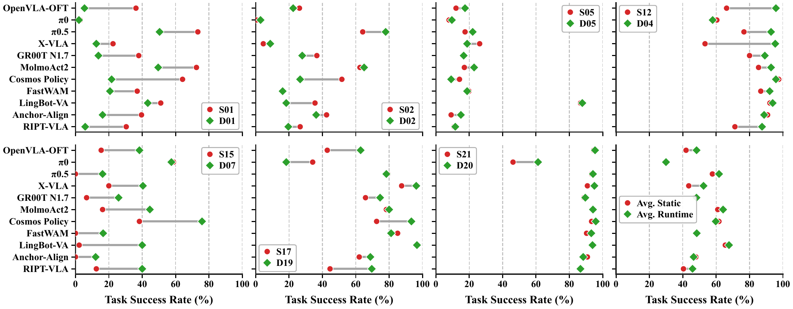

# Paper results and benchmark scope

[Back to the project README](../README.md)

The README leaderboards reproduce the active `tab:static_leaderboard` and
`tab:runtime_leaderboard` tables in `sections/Experiments.tex` from the supplied
LIBERO-Pro2.0 paper source. Commented-out earlier tables are excluded.

## Results

- [Machine-readable paper scores](results/paper-leaderboards.json)
- [Static leaderboard source](results/static-leaderboard.tex)
- [Runtime leaderboard source](results/runtime-leaderboard.tex)

Each table contains 17 policies and nine numerical fields per policy: six
perturbation-category scores, Avg., Base, and Δ. Values retain the paper's
one-decimal precision. The JSON stores the reported values as strings to retain
that precision and includes the SHA-256 of the source experiments file.
README rows are sorted by Avg.; values are not recomputed or taken from the
interactive website.

## Aggregation

Scores are task success rates (%). Base is nominal task success. Δ is
Avg. minus Base in percentage points, computed before rounding in the paper.
Subtracting the displayed, rounded numbers can therefore differ by 0.1 points
from the reported Δ.

Static category scores average valid suite–perturbation entries over
LIBERO-Goal, LIBERO-Object, LIBERO-Spatial, and LIBERO-10. Static Avg. covers
87 valid entries, excluding S04 in LIBERO-Spatial. It is not an unweighted
mean of the six displayed category scores.

| Category | Static IDs in the paper leaderboard | Runtime IDs in the paper leaderboard |
|---|---|---|
| Condition | S01–S05, S07–S09 | D01–D06 |
| Environment | S06, S10–S14, S22 | D07–D09 |
| Observation | S15–S16, S19 | D10–D13 |
| Execution | S20 | D14–D16 |
| Robot | S17–S18 | D17–D19 |
| Language | S21 | D20 |

The ranges above follow the leaderboard table headings. Figure panels may
combine several domains to illustrate mechanisms; they do not redefine the
leaderboard aggregation.

*Original paper figure: comparisons between matched static and runtime
perturbations. These are per-perturbation results, distinct from category
averages in the leaderboards.*

## Paper task partition

The paper samples two held-out tasks per suite with seed 142. Task IDs are
zero-based within each suite.

| Suite | Evaluation IDs | Training-pool IDs |
|---|---|---|
| LIBERO-Spatial | 0, 8 | 1, 2, 3, 4, 5, 6, 7, 9 |
| LIBERO-Object | 1, 8 | 0, 2, 3, 4, 5, 6, 7, 9 |
| LIBERO-Goal | 3, 6 | 0, 1, 2, 4, 5, 7, 8, 9 |
| LIBERO-10 | 5, 8 | 0, 1, 2, 3, 4, 6, 7, 9 |

The paper reports 1,313 training and 335 evaluation shifted instances, totaling
1,648 validated shifted instances, and 39,390 training trajectories.

## Published training package

The linked Hugging Face package currently contains 40,470 stored demonstration
records over 1,349 instances. Its source audit reports 37,396 unique source
trajectories; 106 instances replicate one source trajectory into 30 stored
records. These release records are not a one-to-one count of the paper's
39,390 training trajectories. The README preserves both reported scopes
without claiming equivalence.

Use the [dataset card](https://huggingface.co/datasets/zhouxueyang/LIBERO-Pro2.0)
and [data format guide](https://huggingface.co/datasets/zhouxueyang/LIBERO-Pro2.0/blob/main/docs/data_format.md)
for download scope, schemas, and declared-copy filtering.

## Evaluation service versions

The paper's catalogue uses S01–S22 and D01–D20. Existing service manifests and
older deployment bundles may use legacy case labels, including D21. Use the
pinned service task catalogue and benchmark configuration when reproducing a
run; do not assume that identical labels in different versions denote the
same perturbation. The [grouped evaluation guide](grouped-benchmark.md)
describes the implemented task selection and export interface.

## Figures

- `static/images/overview.png`: rendered directly from `figures/promain.pdf`.
- `static/images/failure-patterns.png`: byte-preserved copy of `figures/example.png`.
- `static/images/static-runtime-comparison.png`: rendered directly from
  `figures/fig_grouped_static_runtime.pdf`.

PDF figures are rendered for browser display; their labels and numbers are
preserved. Source fingerprints are recorded in [figure-sources.json](results/figure-sources.json).
